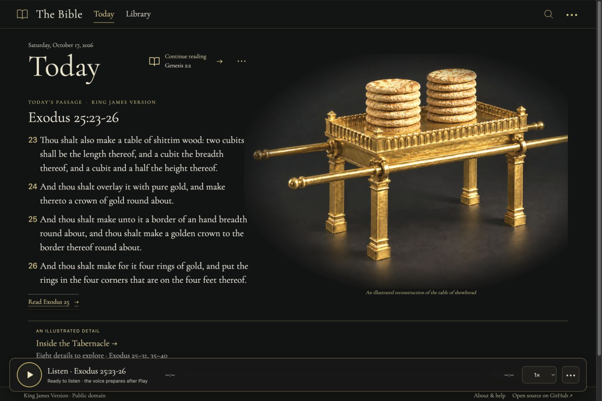
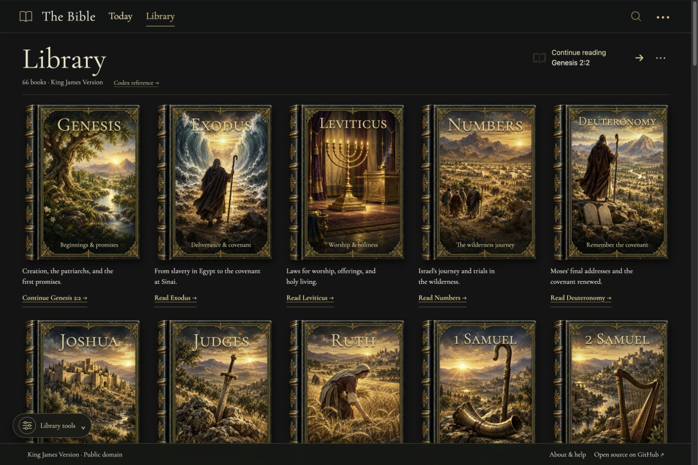

# The Bible

Hosted reader: <https://bible-in-rust.daeshawnballard.chatgpt.site> · Source: <https://github.com/daeshawnballard/rust-bible>

A daily King James Version reading, an illustrated Library of all 66 books, a shared Passage and Journey reader, and a book-organized Bible Codex. Rust powers both the Axum + Tokio server and the browser WebAssembly build; small JavaScript modules connect browser navigation, local reading progress, and speech playback.

## Connected reader

These are local-browser captures of the current connected experience. They document the interface, not hosted deployment behavior.





[Passage — local browser capture](docs/screenshots/connected-reader/reader-local.jpg) · [Journey — local browser capture](docs/screenshots/connected-reader/journey-local.jpg)

## Read, explore, and continue

**Today** opens a short KJV passage, with **Read** for its chapter and **Listen** for that passage. Edition 2 uses a curated 42-day rotation selected from the browser’s local calendar date. Edition 1 remains the original 14-day sequence; its shared links preserve their edition and date. **Link to this day** keeps a selection stable when shared.

**Library** is an illustrated gallery of all 66 books. A cover opens its canonical **Passage** directly. If that book matches the saved reading location, it opens at the exact verse; otherwise it opens at the start of the book. The Passage title menu contains book, chapter, and text settings. **Read** expands the central reading column. **Journey** opens a full-screen view with a reusable window on the right; on mobile, the window appears as a sheet. Its **Scripture**, **Context**, and **Codex** tabs keep the selected view in that window.

**Continue reading** appears on Today and Library and returns to the saved exact verse. Progress is kept in local browser storage on this device, with no account or cloud sync. Clearing site data or using private browsing can affect retention. **Clear** removes the saved location. The Library also restores its filters, cover size, and scroll position within the browser session.

The floating **Library tools** toolbar combines testament and category filters, sorts by Bible order, title, or chapter count, and adjusts cover size. **Reset** returns all 66 books. Tools stay above the audio dock and collapse on narrow screens.

Reference lookup accepts examples such as `John 3:16`, `1 Cor 13:4-7`, and `ps 23`; common abbreviations and typo-tolerant book suggestions are supported. Keyword search returns exact text matches. Scripture passages come verbatim from the embedded KJV corpus; illustrations and editorial notes remain separate from Scripture.

## Journey, illustrations, and Codex

Journey includes fourteen authored story worlds. Eight new worlds cover Joshua 3–4, 1 Samuel 17, Daniel 6, Jonah 1–4, Matthew 14:13–36, Luke 24, John 4, and Acts 27–28, alongside the original scenes: Genesis 2–4, Noah and the flood (Genesis 7–9:17), the Exodus wilderness (Exodus 13:17–17), Ruth 1–2, Luke 2, and Mark 4–5. The artwork compresses times and places into an artistic storyboard. The active stop follows the current verse while reading or listening. Inspecting a hotspot does not move the verse; its explicit **Read** source link jumps to the linked passage.

The existing illustrated object studies cover Noah’s Ark (Genesis 6–9), the Tabernacle (Exodus 25–31 and 35–40), and the Sower (Matthew 13). Their hotspots and detail artwork stay alongside Scripture. Journey coverage and curated geographic settings are limited to the ranges in the [reader companion notes](docs/reader-companion.md); unsupported passages remain readable without an assigned setting. Acts 16–17 and Revelation 1:9 use curated geographic context. Terrain uses modern imagery and elevation data, needs a network connection and WebGL, and is not a reconstruction of ancient routes. See [atlas attribution and limits](docs/atlas-data.md).

The **Bible Codex** is one book-organized guide with 360 selected entries across all 66 books, grouped as People, Places, Miracles, and Study notes. Entries point to KJV references. It is a curated guide, not an exhaustive index or a substitute for Scripture.

The 66 cover paintings were generated individually with built-in ImageGen from the approved Library reference. Titles, descriptions, links, and controls are live interface elements; generated binding overlays are separate from the paintings. Original cover PNGs are in `assets/imagegen/source/covers/`, production WebPs are in `web/art/covers/`, and prompts, source output identifiers, processing, and dimensions are recorded in the [asset manifest](assets/imagegen/manifest.json), [per-book provenance](assets/imagegen/covers/), and [artwork notes](docs/library-artwork.md). Journey prompts and source notes are in `assets/imagegen/journey/` and [illustrated journey notes](docs/illustrated-journeys.md). The approved references are in `assets/imagegen/reference/`; the Genesis immersive background has [source and generation provenance](assets/imagegen/journey/genesis-immersive-v1.json). The three object studies retain their [Tabernacle sources](docs/tabernacle-sources.md) and [illustration sources](docs/learning-sources.md).

## Listening and local progress

The Passage reader starts from the selected verse and continues into later chapters. Today’s Listen reads only its selected daily passage.

The verse being narrated receives a gold highlight in Read, Journey, and Today. It advances when the next verse actually starts playing, stays on that verse while paused, and clears when playback stops or finishes. Turning off **Follow the spoken verse** disables automatic scrolling while keeping the audio highlight.

One bottom audio dock follows the active narration across SPA navigation among Today, Library, and Codex. It names the passage being narrated and has **Return to passage**. Choosing **Listen** for another reference explicitly changes the narration target; a **Read** source link in Context or Codex stops it and opens that reference. Reloading does not autoplay. Kokoro speech is generated locally; its waveform, elapsed time, and seek control describe the generated audio chunk. Device voices do not provide audio timing, so those controls are unavailable for them. Pause/resume, speed, voice, volume, and Follow reading are available in playback controls.

Narration prepares a small buffer of exact upcoming segments and reuses them during playback. This adds an initial preparation wait and reduces avoidable regeneration; slower devices may still pause between segments. Preparation stays on the device and the queue remains bounded.

The first Kokoro listen downloads about 100 MB of public model files. Speech is generated on the device from KJV text; no paid narration API is used. The available voice catalog does not identify speakers by race, so voices are not labeled Black. All narration is synthetic.

## Run the app

### Native server

Requirements: a current stable Rust toolchain. The KJV JSON is embedded with `include_str!`, so the running server needs no separate corpus file.

```sh
cargo run --release
```

Open <http://localhost:3000>. The Axum server binds to `0.0.0.0:3000`.

### Static WebAssembly site

Install the target once, then build:

```sh
rustup target add wasm32-unknown-unknown
./scripts/build-wasm.sh
```

The build writes the site shell and WASM module, Today artwork, all 66 cover WebPs, and the illustrated scene, object-detail, and Genesis Journey assets to `dist/`. Publish the contents of `dist/` on a static host. Original ImageGen PNGs and provenance remain in the source repository. The page reports WebAssembly or asset-loading errors and includes a no-JavaScript message. It does not use `wasm-bindgen`, `wasm-pack`, or a server process.

To preview the build locally:

```sh
python3 -m http.server 8000 --directory dist
```

Then open <http://localhost:8000>.

### API boundary

The native service keeps JSON routes such as `/api/verse?ref=John+3:16` and `/api/search?q=faith`. A static host cannot run Axum or expose those as HTTP endpoints. The same handlers are available inside the browser through the Rust WASM adapter, for example `window.rustBibleApi("/api/verse?ref=John%203%3A16")`. This returns a parsed JSON object by calling Rust in the page; it is not a network endpoint.

## Data and license

The embedded corpus is the [King James Version JSON](https://raw.githubusercontent.com/thiagobodruk/bible/master/json/en_kjv.json) from [thiagobodruk/bible](https://github.com/thiagobodruk/bible). Its source book names are Portuguese; English names are supplied in code by book order. KJV text is public domain. Code is released under the MIT License; see [`LICENSE`](LICENSE).
