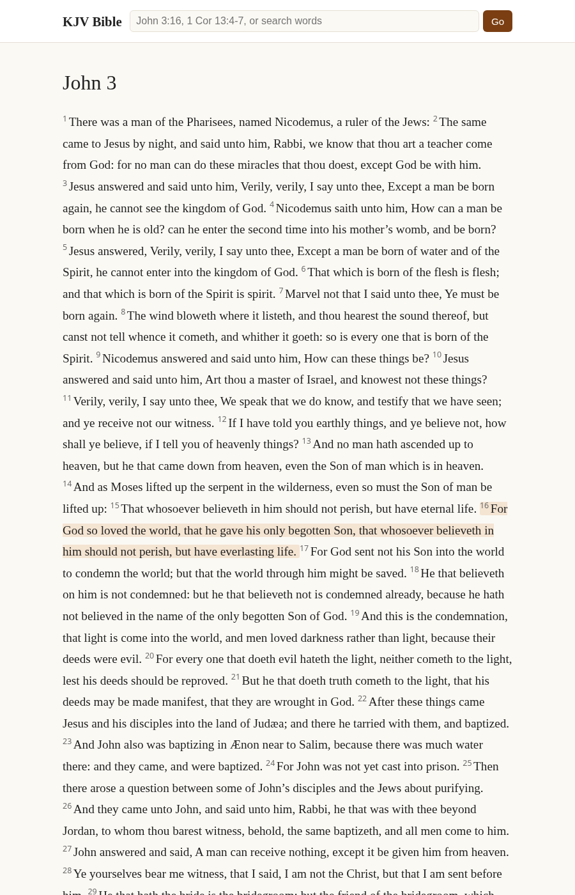

# rust-bible — KJV Bible reader

A small self-contained web app (axum + tokio) for reading the King James Version.

## Requirements
- Rust stable (1.75+; built with 1.85) — install via https://rustup.rs if missing.
- No runtime data files: the KJV JSON is embedded in the binary with `include_str!`.

## Run
    cargo run --release
Then open http://localhost:3000 (server binds 0.0.0.0:3000).

## Features
- `/` all 66 books · `/book/John` chapter list · `/book/John/3` chapter with verse numbers and prev/next links
- Lookup box: `John 3:16`, `John 3`, `1 Cor 13:4-7`, `ps 23` (case-insensitive, common abbreviations); anything else runs a full-text search (all words must match, max 200 results)
- JSON API: `/api/verse?ref=John+3:16`, `/api/search?q=faith`

## Data source
https://raw.githubusercontent.com/thiagobodruk/bible/master/json/en_kjv.json (KJV, public domain).
Note: that file's book names are in Portuguese, so English names are supplied in code by book order.

## License

Code is released under the MIT License (see `LICENSE`). The King James Version text is in the public domain, sourced from [thiagobodruk/bible](https://github.com/thiagobodruk/bible).
