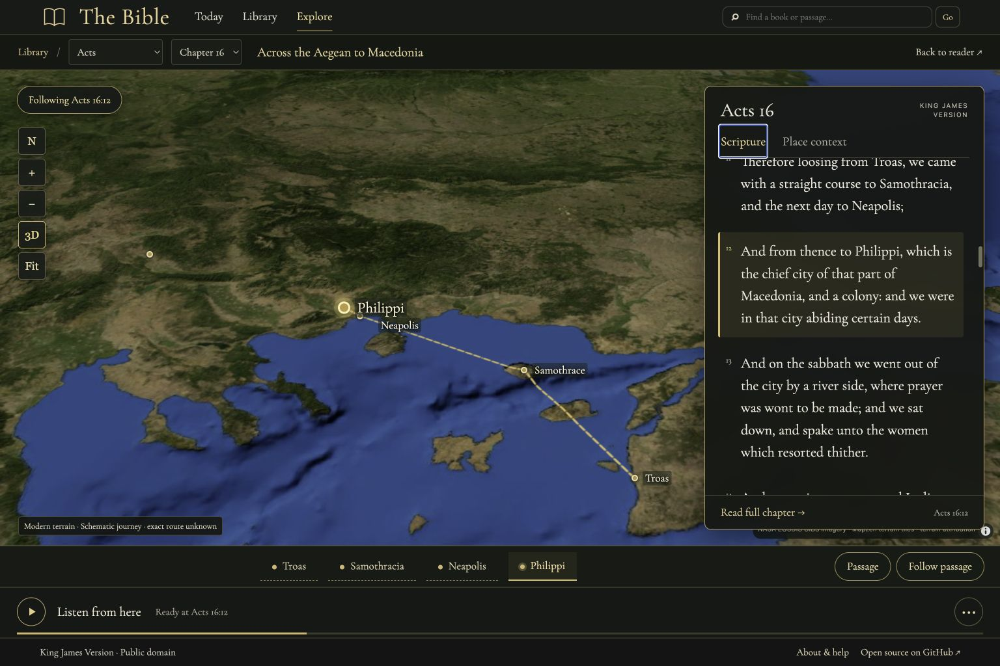

# The Bible

Hosted reader: <https://bible-in-rust.daeshawnballard.chatgpt.site>. Open-source repository: <https://github.com/daeshawnballard/rust-bible>.


A daily KJV reading, chapter reader, illustrated Library, and passage-following geographic Explore map with one shared Rust implementation. The **About** page explains how to read, listen, and use local reading progress. Run the site as the original Axum + Tokio server, or build it as Rust WebAssembly for static hosting. Rust handles Bible lookup, reference parsing, search, Library filtering and sorting, and page rendering. Small JavaScript modules connect browser routes, Library controls, and device speech playback to that Rust implementation.

## Today and navigation

**Today** is the default homepage: a short KJV passage, a separate illustration, **Read** for its full chapter, and **Listen** for that passage. Edition 2 uses a clearly labeled, curated 42-day rotation selected from the browser’s local calendar date. The original edition 1 remains an immutable 14-day sequence, and its shared links keep their edition and date. **Link to this day** preserves both so the selection stays stable when shared. Illustrations are artistic interpretations; Scripture comes verbatim from the embedded corpus.

**Library** is the gallery of all 66 books. A cover opens its book overview, and a chapter button opens the chapter reader. Reader breadcrumbs follow **Library / Book / Chapter**. The header stays consistent throughout the site. Listening belongs to the passage, chapter, book, or Explore scene currently open. **Explore** opens a real terrain map at your shared reading position. Illustrated studies remain available inside its Place context tab. **About** offers getting-started links and common answers.

**Continue reading** remembers the exact verse on this browser/device after a chapter is opened. The saved location uses browser-local storage; it is not an account or cloud sync. **Clear** on Today removes that saved location. Clearing site data or using private browsing can affect retention. The Library also restores its filters, cover size, and scroll position within the browser session.

**About and help** is available at `/about`. It explains passage lookup, reading and listening controls, illustrated-scene notes, and local progress.

## Illustrated Library

The Library is a gallery of all 66 books, with individual painted cover illustrations, live HTML titles, short editorial descriptions, and chapter links. Each cover opens its book's chapter navigation; the **Read** link starts chapter 1.

The Library uses medium-weight descriptions and stronger reading links, with restrained gold highlights on its dimensional covers. The compact floating **Library tools** bar filters by testament and category, sorts by Bible order, title, or chapter count, and changes cover size. Filters combine, selections are reflected in the URL, and **Reset** returns to all 66 books. On narrow screens the toolbar can collapse and the gallery adjusts to the available width. The header retains the reader's explicit fuzzy book suggestions and passage lookup.

The 66 cover scenes were generated individually with built-in ImageGen from the approved Library reference. Titles, descriptions, links, and controls remain live HTML/CSS. A generated transparent binding overlay supplies the dimensional leather spine, raised bands, and ornate gold tooling; each painting remains a separate image. These illustrations and descriptions are editorial aids, separate from the KJV text. Original PNGs are preserved in `assets/imagegen/source/covers/`, optimized production WebPs in `web/art/covers/`, and prompts, source output identifiers, processing, and dimensions in [the asset manifest](assets/imagegen/manifest.json) and [per-book provenance](assets/imagegen/covers/). See [artwork notes](docs/library-artwork.md).

## Illustrated book pages


Each of the 66 covers opens an illustrated book overview with its title, testament, literary category, short description, and every chapter. **Begin reading** opens chapter 1; any numbered chapter opens that chapter in the existing reader. Psalms includes all 150 chapters, and single-chapter books have one chapter link. The cover, controls, and chapter grid adapt to narrow screens.

**Listen to [book]** reads the book's KJV verses using a browser/device voice. When your saved reading location is in that book, playback starts at its exact verse; otherwise it starts at chapter 1. The button toggles pause/resume, and playback reveals stop, speed, and voice controls plus the current chapter and verse. Navigation cancels playback. The editorial description is never added to the speech payload. Voice support depends on the browser/device.

The approved ImageGen book-page concept is preserved in `assets/imagegen/reference/book-page-approved.png`. The page reuses the Library's individual cover paintings and shared dimensional binding, with locally hosted Cormorant Garamond typography, a detailed ImageGen leather-and-gold binding, and licensed Phosphor icons. [Design QA](design-qa.md) records the reference comparison and visual differences. The application remains Rust/WASM, with a small JavaScript adapter for actual device speech.

## Native server

Requirements: a current stable Rust toolchain. The KJV JSON is embedded in the binary with `include_str!`, so no runtime data file is needed.

```sh
cargo run --release
```

Open <http://localhost:3000>. The server binds to `0.0.0.0:3000`.

## Static browser build

Install the WebAssembly target once:

```sh
rustup target add wasm32-unknown-unknown
```

Build the static site:

```sh
./scripts/build-wasm.sh
```

The command writes the site shell and WASM module, Today artwork, all 66 cover WebPs, and the illustrated Explore scene and detail assets to `dist/`. Publish the contents of `dist/` on any static host. Original ImageGen PNGs and provenance stay in the source repository and are not copied into the deployed bundle. The page shows a loading state, reports WebAssembly or asset-loading errors, and includes a no-JavaScript message. It does not use `wasm-bindgen`, `wasm-pack`, or a server-side process.

For a local static preview after building:

```sh
python3 -m http.server 8000 --directory dist
```

Then open <http://localhost:8000>.

The native service keeps its JSON routes:

- `/api/verse?ref=John+3:16`
- `/api/search?q=faith`

A static host cannot run Axum or provide these as HTTP endpoints. The same JSON behavior is available inside the browser page through the Rust WASM adapter, for example `window.rustBibleApi("/api/verse?ref=John%203%3A16")`. It returns the parsed JSON object. This hosted API boundary is an in-page JavaScript call into Rust WebAssembly, not a network endpoint.

## Reader features


- A quiet chapter reader for all 66 books, with book/chapter selectors, contextual speech controls, and previous/next chapter links across book boundaries.
- Short readings continue directly into following Scripture, with clear chapter headings and **Open chapter** links. Verse lookups show the requested range first, then continue after its final verse. The initial page includes whole following chapters until at least 16 verses are rendered (at most three added sections, or the end of Scripture); a **Continue with…** link opens the next unread chapter. The end of Revelation stops naturally.
- **Listen from here** reads the selected Scripture and continues into following chapters. Further chapters are appended by the Rust renderer as playback reaches the end of the displayed text, through the end of Revelation. The current verse is highlighted; **Follow reading** scrolls it into view and can be switched off under **Playback options**. Playback controls stay accessible while reading. Pause/resume, stop, voice/speed settings, and cancellation on navigation remain available. Today and each Explore scene read only their own Scripture selections.
- **Continue reading** remembers the exact verse on this browser/device. Settled scrolling saves the verse at the reading line; during audio, the currently spoken verse takes precedence. Today’s Continue reading link and reloading the same chapter return to that verse, including chapters reached through continuous reading. **Listen from here** starts there after a click. A book’s overview Listen button also resumes its saved verse when it is the bookmarked book. Older chapter-only bookmarks still open correctly. Use **Clear** on Today to remove the bookmark. Progress uses local browser storage, with no account or cloud sync; clearing site data or private browsing can affect retention. If storage is unavailable, reading and speech remain usable but progress may not survive a reload.
- Reference lookup such as `John 3:16`, `John 3`, `1 Cor 13:4-7`, and `ps 23`; names are case-insensitive and common abbreviations are supported.
- Typo-tolerant book suggestions: `neimai` suggests Nehemiah, and `jhon` suggests John. Chapter and verse requests stay attached to valid suggestions. Corrections are explicit links; keyword search still returns exact text matches.
- Full-text search where every query word must match, with up to 200 displayed results and escaped highlighting.
- Verse ranges and highlighted chapter links.

## Three illustrated Explore scenes


Explore includes the Tabernacle, Noah’s Ark, and the Sower’s Field. The Tabernacle has eight guided hotspots; the Ark and Sower scenes have four each, for 16 hotspots total. In every scene, Scripture is the default view in a fixed right-hand panel with its own scroll area. A hotspot opens a dedicated detail illustration and explanation in that panel. **Back to Scripture** returns to the passage for the selected stop. Previous/next controls move through guided stops and their questions, which point back to named passages. A labeled selector provides another way to choose a stop on narrow screens. Rust renders the scenes’ hotspots, panel views, selections, references, explanations, and KJV content in both native and WASM builds.

## Reading-following map



**Explore** (`#/explore`) follows the shared reading bookmark. **Map this passage** in the reader opens the same chapter and verse beside the map; **Back to reader** returns there. Choose a verse or scroll the Scripture panel to update the bookmark. Listening continues through later chapters and updates geographic context with the spoken verse. Pan freely, then use **Return to passage** to resume the camera; use 2D/3D, zoom, north, or chapter overview controls independently. On narrow screens the map and passage stack, with a **Passage** toggle for more map space.

All 66 books can be selected. The bundled KJV-qualified OpenBible index has candidate locations in 824 chapters across 61 books. A named place is not automatically the story setting: explicit camera-follow ranges currently cover Acts 16–17, Luke 2, and Revelation 1:9. Other chapters show their named places or book context and clearly state that no narrative setting is assigned. Books with no mappable references still have their complete Scripture. No earthly pin is invented for visionary New Jerusalem. Acts 16:11 contains three journey stops in one verse; its follow setting is the last named stop, Neapolis. The stop buttons open their shared verse.

Geographic notes, identification confidence and external source links live in **Place context**, separate from canonical Scripture and speech. The dashed Acts 16 connections are schematic, not a reconstructed ancient route. Modern NASA Blue Marble regional imagery (approximately 500 m, not street-level) and Mapzen elevation tiles require a network connection and WebGL. If the map fails, the Scripture, place list and reader links remain available. Tile providers receive normal map asset requests; the app does not request your physical location. See [atlas data, attribution and limits](docs/atlas-data.md), [vendored renderer provenance](web/vendor/maplibre/provenance.json), and the licenses there.

The three illustrated studies and all 16 dedicated hotspots remain at `#/explore/studies`; existing scene links remain valid. The approved map concept is preserved in `assets/imagegen/reference/reading-map-approved.png` as design provenance only. Generated geography is not used as map imagery. The app, Scripture and API/page rendering stay in Rust/WASM; a small MapLibre JavaScript bridge supplies browser WebGL terrain.


The Tabernacle’s eight object close-ups are individual illustrations, not crops of the scene image. The Ark and Sower scenes add two scene illustrations and eight dedicated detail illustrations; the existing 66 book covers remain their own assets. Explore artwork consists of artistic interpretations and reconstructions, not archaeological evidence or proof of historical appearance. Asset provenance is recorded in [the image manifest](assets/imagegen/manifest.json); see also [Library artwork notes](docs/library-artwork.md) and [Tabernacle source notes](docs/tabernacle-sources.md).

Scripture is rendered verbatim from the embedded KJV corpus. **Explanation** is a separate, explicitly labeled section with passage references; it is not added to Scripture playback. Source-bound questions and explanations remain separate from Scripture and point to their cited passages.

Chapter and passage readers use continuous **Listen from here** playback; Today reads only its current passage, and Explore reads only the current scene’s Scripture. The controls include pause/resume, stop, speed, and voice selection. Speech uses the browser’s Web Speech API and available device voices, so there are no embedded recordings and no API key is required. Voice availability and pronunciation depend on the browser/device. Playback starts only after a user action, highlights the current verse, and stops on navigation. Browsers without working speech support show an explicit unavailable/error message.

## Data source

<https://raw.githubusercontent.com/thiagobodruk/bible/master/json/en_kjv.json> (KJV, public domain). The source file's book names are in Portuguese, so English names are supplied in code by book order.

## License

Code is released under the MIT License (see `LICENSE`). The King James Version text is in the public domain, sourced from [thiagobodruk/bible](https://github.com/thiagobodruk/bible).
