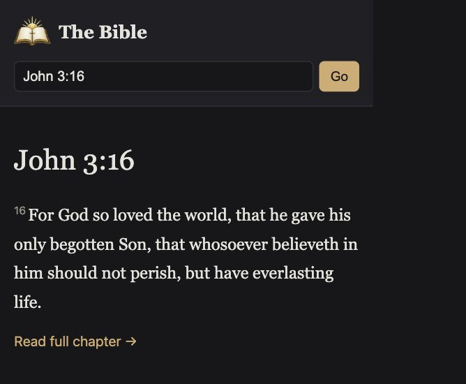

# The Bible

Hosted reader: <https://bible-in-rust.daeshawnballard.chatgpt.site>. Open-source repository: <https://github.com/daeshawnballard/rust-bible>.



A small KJV reader with one shared Rust implementation. Run it as the original Axum + Tokio server, or build it as Rust WebAssembly for static hosting. The static browser app uses Rust for Bible lookup, reference parsing, search, and page rendering; its small JavaScript file only loads the module, passes routes through the ABI, and updates the page.

## Native server

Requirements: a current stable Rust toolchain. The KJV JSON is embedded in the binary with `include_str!`, so no runtime data file is needed.

```sh
cargo run --release
```

Open <http://localhost:3000>. The server binds to `0.0.0.0:3000`.

## Static browser build

Install the WebAssembly target once:

```sh
rustup target add wasm32-unknown-unknown
```

Build the static site:

```sh
./scripts/build-wasm.sh
```

The command writes `dist/index.html`, `dist/app.js`, `dist/style.css`, `dist/logo.png`, `dist/experience.js`, `dist/art/tabernacle.webp`, and `dist/rust_bible.wasm`. Publish the contents of `dist/` on any static host. The page shows a loading state, reports WebAssembly or asset-loading errors, and includes a no-JavaScript message. It does not use `wasm-bindgen`, `wasm-pack`, or a server-side process.

For a local static preview after building:

```sh
python3 -m http.server 8000 --directory dist
```

Then open <http://localhost:8000>.

The native service keeps its JSON routes:

- `/api/verse?ref=John+3:16`
- `/api/search?q=faith`

A static host cannot run Axum or provide these as HTTP endpoints. The same JSON behavior is available inside the browser page through the Rust WASM adapter, for example `window.rustBibleApi("/api/verse?ref=John%203%3A16")`. It returns the parsed JSON object. This hosted API boundary is an in-page JavaScript call into Rust WebAssembly, not a network endpoint.

## Reader features

- All 66 books and chapter navigation, with previous and next chapter links across book boundaries.
- Reference lookup such as `John 3:16`, `John 3`, `1 Cor 13:4-7`, and `ps 23`; names are case-insensitive and common abbreviations are supported.
- Typo-tolerant book suggestions: `neimai` suggests Nehemiah, and `jhon` suggests John. Chapter and verse requests stay attached to valid suggestions. Corrections are explicit links; keyword search still returns exact text matches.
- Full-text search where every query word must match, with up to 200 displayed results and escaped highlighting.
- Verse ranges and highlighted chapter links.

## Explore and listen


Choose **Explore** to open a detailed illustrated Tabernacle scene. Scripture is the default view in a fixed-size right-hand panel with its own scroll area. Eight clickable scene hotspots switch that same panel to an object close-up and a short explanation. **Back to Scripture** or the panel’s **Scripture** link returns to the selected object’s KJV passage. The object-button row and separate drawer are removed. Rust renders the hotspots, panel views, selections, references, explanations, and KJV content in both native and WASM builds.

The scene is an AI-generated artistic reconstruction, not an archaeological model. Asset provenance is recorded in [the image manifest](assets/imagegen/manifest.json). The artwork uses the approved visual concept; its depicted proportions, details, and placement are illustrative.

Scripture is rendered verbatim from the embedded KJV corpus. **Explanation** is a separate, explicitly labeled section with passage references; it is not added to Scripture playback. The supporting references are listed in [the scene source notes](docs/tabernacle-sources.md).

Chapter, passage, and Explore pages include **Listen to Scripture**, pause/resume, stop, speed, and voice controls. Speech uses the browser's Web Speech API and available device voices, so no API key is embedded or required. Voice availability and pronunciation depend on the browser/device. Playback starts only after a user action, highlights the current verse, and stops on navigation. Browsers without working speech support show an explicit unavailable/error message.

## Data source

<https://raw.githubusercontent.com/thiagobodruk/bible/master/json/en_kjv.json> (KJV, public domain). The source file's book names are in Portuguese, so English names are supplied in code by book order.

## License

Code is released under the MIT License (see `LICENSE`). The King James Version text is in the public domain, sourced from [thiagobodruk/bible](https://github.com/thiagobodruk/bible).
