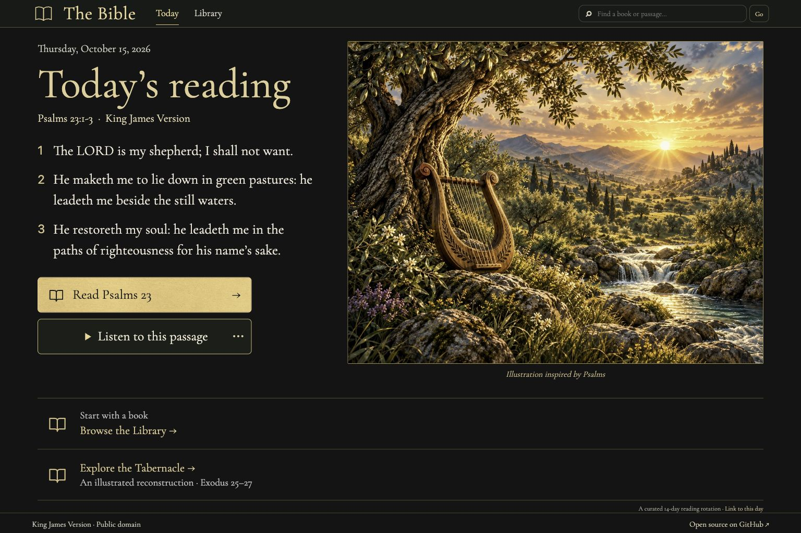
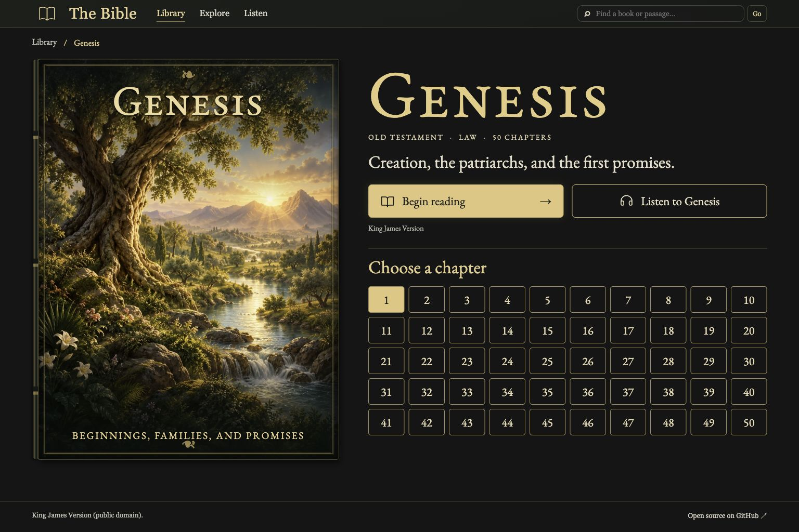
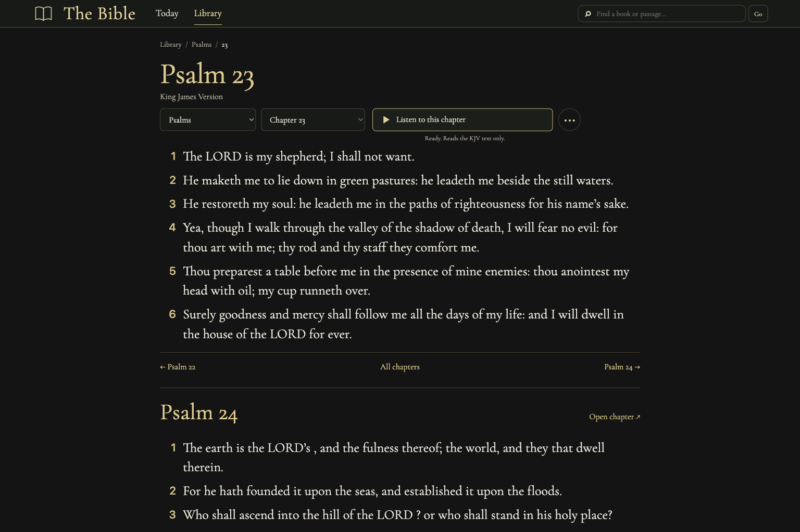
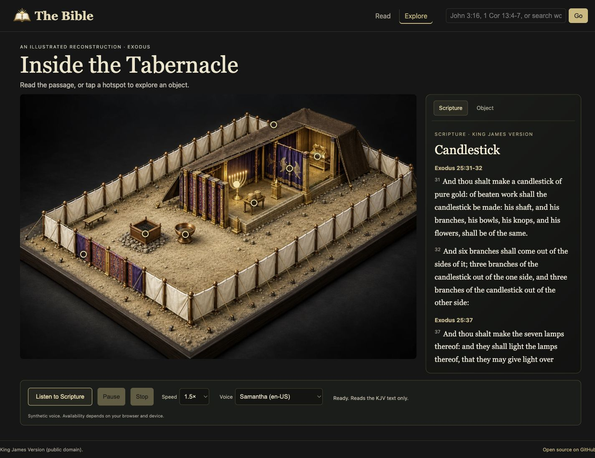
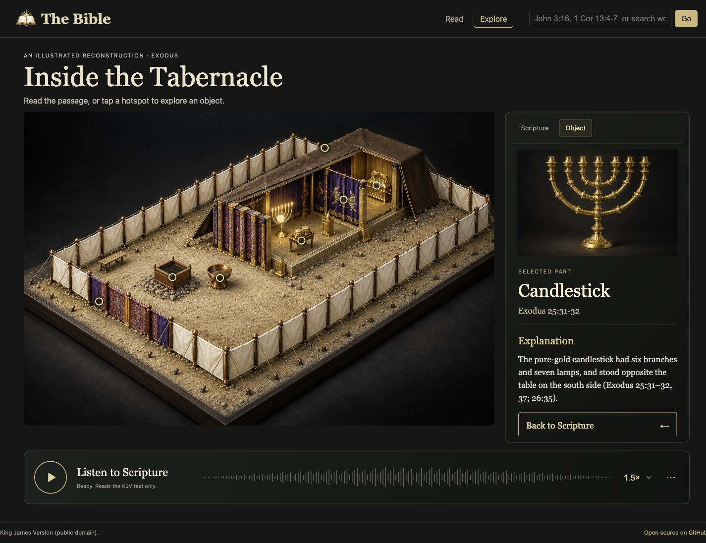

# The Bible

Hosted reader: <https://bible-in-rust.daeshawnballard.chatgpt.site>. Open-source repository: <https://github.com/daeshawnballard/rust-bible>.



A daily KJV reading, chapter reader, and illustrated Library with one shared Rust implementation. Run it as the original Axum + Tokio server, or build it as Rust WebAssembly for static hosting. Rust handles Bible lookup, reference parsing, search, Library filtering and sorting, and page rendering. Small JavaScript modules connect browser routes, Library controls, and device speech playback to that Rust implementation.

## Today and navigation

**Today** is the default homepage: a short KJV passage, a separate illustration, **Read** for its full chapter, and **Listen** for that passage. Edition 1 uses a clearly labeled, curated 14-day rotation. The browser selects the day using its local calendar date. **Link to this day** retains the date and edition so the selection is stable when shared. Illustrations are artistic interpretations; Scripture comes verbatim from the embedded corpus.

**Library** is the gallery of all 66 books. A cover opens its book overview, and a chapter button opens the chapter reader. Reader breadcrumbs follow **Library / Book / Chapter**. The header stays consistent throughout the site. Listening belongs to the passage, chapter, or book currently open. The named **Explore the Tabernacle** feature is on Today.

**Last opened on this device** appears after a chapter is opened and survives reloads. It stores only the book, chapter, route, and timestamp in browser-local storage; it is not an account, reading-completion measure, or cross-device sync. **Clear** removes that saved location. The Library also restores its filters, cover size, and scroll position within the browser session.

## Illustrated Library

The Library is a gallery of all 66 books, with individual painted cover illustrations, live HTML titles, short editorial descriptions, and chapter links. Each cover opens its book's chapter navigation; the **Read** link starts chapter 1.

The Library uses medium-weight descriptions and stronger reading links, with restrained gold highlights on its dimensional covers. The compact floating **Library tools** bar filters by testament and category, sorts by Bible order, title, or chapter count, and changes cover size. Filters combine, selections are reflected in the URL, and **Reset** returns to all 66 books. On narrow screens the toolbar can collapse and the gallery adjusts to the available width. The header retains the reader's explicit fuzzy book suggestions and passage lookup.

The 66 cover scenes were generated individually with built-in ImageGen from the approved Library reference. Titles, descriptions, links, and controls remain live HTML/CSS. A generated transparent binding overlay supplies the dimensional leather spine, raised bands, and ornate gold tooling; each painting remains a separate image. These illustrations and descriptions are editorial aids, separate from the KJV text. Original PNGs are preserved in `assets/imagegen/source/covers/`, optimized production WebPs in `web/art/covers/`, and prompts, source output identifiers, processing, and dimensions in [the asset manifest](assets/imagegen/manifest.json) and [per-book provenance](assets/imagegen/covers/). See [artwork notes](docs/library-artwork.md).

## Illustrated book pages



Each of the 66 covers opens an illustrated book overview with its title, testament, literary category, short description, and every chapter. **Begin reading** opens chapter 1; any numbered chapter opens that chapter in the existing reader. Psalms includes all 150 chapters, and single-chapter books have one chapter link. The cover, controls, and chapter grid adapt to narrow screens.

**Listen to [book]** starts device speech at chapter 1 and continues through the book's KJV verses. The button toggles pause/resume, and playback reveals stop, speed, and voice controls plus the current chapter and verse. Navigation cancels playback. The editorial description is never added to the speech payload. This uses the same browser/device voice service as the reader and Tabernacle; voice support depends on the browser. A book is restarted from chapter 1 after stopping or changing voice/speed.

The approved ImageGen book-page concept is preserved in `assets/imagegen/reference/book-page-approved.png`. The page reuses the Library's individual cover paintings and shared dimensional binding, with locally hosted Cormorant Garamond typography, a detailed ImageGen leather-and-gold binding, and licensed Phosphor icons. [Design QA](design-qa.md) records the reference comparison and visual differences. The application remains Rust/WASM, with a small JavaScript adapter for actual device speech.

## Native server

Requirements: a current stable Rust toolchain. The KJV JSON is embedded in the binary with `include_str!`, so no runtime data file is needed.

```sh
cargo run --release
```

Open <http://localhost:3000>. The server binds to `0.0.0.0:3000`.

## Static browser build

Install the WebAssembly target once:

```sh
rustup target add wasm32-unknown-unknown
```

Build the static site:

```sh
./scripts/build-wasm.sh
```

The command writes the site shell and WASM module, the Today illustration to `dist/art/today/`, all 66 cover WebPs to `dist/art/covers/`, `dist/art/tabernacle.webp` for the interactive scene, and all eight dedicated object images to `dist/art/objects/`. Publish the contents of `dist/` on any static host. Original ImageGen PNGs and provenance stay in the source repository and are not copied into the deployed bundle. The page shows a loading state, reports WebAssembly or asset-loading errors, and includes a no-JavaScript message. It does not use `wasm-bindgen`, `wasm-pack`, or a server-side process.

For a local static preview after building:

```sh
python3 -m http.server 8000 --directory dist
```

Then open <http://localhost:8000>.

The native service keeps its JSON routes:

- `/api/verse?ref=John+3:16`
- `/api/search?q=faith`

A static host cannot run Axum or provide these as HTTP endpoints. The same JSON behavior is available inside the browser page through the Rust WASM adapter, for example `window.rustBibleApi("/api/verse?ref=John%203%3A16")`. It returns the parsed JSON object. This hosted API boundary is an in-page JavaScript call into Rust WebAssembly, not a network endpoint.

## Reader features



- A quiet chapter reader for all 66 books, with book/chapter selectors, contextual speech controls, and previous/next chapter links across book boundaries.
- Short readings continue directly into following Scripture, with clear chapter headings and **Open chapter** links. Verse lookups show the requested range first, then continue after its final verse. The initial page includes whole following chapters until at least 16 verses are rendered (at most three added sections, or the end of Scripture); a **Continue with…** link opens the next unread chapter. The end of Revelation stops naturally.
- **Listen from here** reads the selected Scripture and continues into following chapters. Further chapters are appended by the Rust renderer as playback reaches the end of the displayed text, through the end of Revelation. The current verse is highlighted; **Follow reading** scrolls it into view and can be switched off under **Playback options**. Playback controls stay accessible while reading. Pause/resume, stop, voice/speed settings, and cancellation on navigation remain available. Today and Tabernacle still read only their own Scripture selections.
- Reference lookup such as `John 3:16`, `John 3`, `1 Cor 13:4-7`, and `ps 23`; names are case-insensitive and common abbreviations are supported.
- Typo-tolerant book suggestions: `neimai` suggests Nehemiah, and `jhon` suggests John. Chapter and verse requests stay attached to valid suggestions. Corrections are explicit links; keyword search still returns exact text matches.
- Full-text search where every query word must match, with up to 200 displayed results and escaped highlighting.
- Verse ranges and highlighted chapter links.

## Explore and listen



Choose **Explore the Tabernacle** on Today to open a detailed illustrated Tabernacle scene. Scripture is the default view in a fixed-size right-hand panel with its own scroll area. Eight clickable scene hotspots switch that same panel to one of eight dedicated object illustrations and a short explanation. **Back to Scripture** or the panel’s **Scripture** link returns to the selected object’s KJV passage. A labeled part selector inside the Scripture panel provides an alternative to the scene hotspots on small screens. The outside object-button row and separate drawer are removed. Rust renders the hotspots, panel views, selections, references, explanations, and KJV content in both native and WASM builds.



The scene and the eight object close-ups are separate AI-generated artistic reconstructions, not archaeological models. The close-ups are served from `web/art/objects/{courtyard,altar,basin,tent,table,lamp,veil,ark}.webp`; they are individual illustrations, not crops of the scene image. Asset provenance is recorded in [the image manifest](assets/imagegen/manifest.json). The artwork uses the approved visual concept; its depicted proportions, details, and placement are illustrative.

Scripture is rendered verbatim from the embedded KJV corpus. **Explanation** is a separate, explicitly labeled section with passage references; it is not added to Scripture playback. The supporting references are listed in [the scene source notes](docs/tabernacle-sources.md).

Chapter and passage readers use continuous **Listen from here** playback; Today keeps a contextual **Listen to this passage** button. Both include pause/resume, stop, speed, and voice controls. The Tabernacle includes **Listen to Scripture**. Explore uses the concept’s circular play/pause button and waveform-styled bar; extra voice and stop controls sit under **Playback options**. The waveform is decorative, not sampled audio or a seekable timeline. Speech uses the browser's Web Speech API and available device voices, so no API key is embedded or required. Voice availability and pronunciation depend on the browser/device. Playback starts only after a user action, highlights the current verse, and stops on navigation. Browsers without working speech support show an explicit unavailable/error message.

## Data source

<https://raw.githubusercontent.com/thiagobodruk/bible/master/json/en_kjv.json> (KJV, public domain). The source file's book names are in Portuguese, so English names are supplied in code by book order.

## License

Code is released under the MIT License (see `LICENSE`). The King James Version text is in the public domain, sourced from [thiagobodruk/bible](https://github.com/thiagobodruk/bible).
