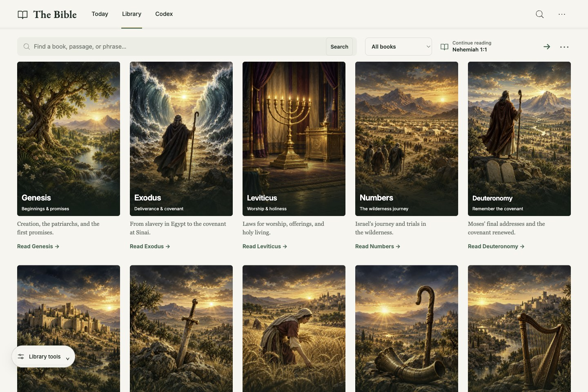

# The Bible

Hosted reader: <https://daeshawnballard.com/projects/bibleinrust/> · ChatGPT Site: <https://bible-in-rust.daeshawnballard.chatgpt.site> · Source: <https://github.com/daeshawnballard/rust-bible>

A daily King James Version reading, an illustrated Library of all 66 books, a shared Passage and Journey reader, and a book-organized Bible Codex. Rust powers both the Axum + Tokio server and the browser WebAssembly build; small JavaScript modules connect browser navigation, local reading progress, and speech playback.

The portfolio serves the reader beneath `/projects/bibleinrust/` through a read-only proxy to the public ChatGPT Site. The same Rust/WASM build resolves artwork, fonts, modules, and hosted Heart/Michael recordings relative to its deployment directory. Saved progress remains local to the browser origin; the custom domain and ChatGPT Site have separate browser storage.

## Ivory and forest interface

The selected [ivory/forest reference](assets/imagegen/reference/ivory-forest-approved.png) guides the current interface: warm ivory surfaces, dark green text, forest accents, Inter for controls, and Garamond for Scripture. Library and Codex start with search directly beneath navigation, without repeated page mastheads. All titles, notes, filters, and playback controls are real interface elements.

These captures document the local browser rendering; deployment acceptance is separate.



[Today](docs/screenshots/ivory-forest/today-local.jpg) · [Codex](docs/screenshots/ivory-forest/codex-local.jpg) · [Journey](docs/screenshots/ivory-forest/journey-local.jpg)

## Read, explore, and continue

**Today** opens a short KJV passage, with **Read** for its chapter and **Listen** for that passage. Edition 2 uses a curated 42-day rotation selected from the browser’s local calendar date. Edition 1 remains the original 14-day sequence; its shared links preserve their edition and date. **Link to this day** keeps a selection stable when shared.

The Elijah selection (1 Kings 19:11–13) uses a dedicated illustration of Elijah covering his face at the cave entrance (verse 13), labeled as an artistic reconstruction. Its [ImageGen prompt and provenance](assets/imagegen/today-elijah-provenance.json), original PNG, and production WebP are included. Psalm 23 uses a dedicated shepherd-and-valley landscape with [ImageGen provenance](assets/imagegen/ivory-psalm23-provenance.json). Other readings still use their existing artwork; this is not a completed passage-specific art set for the entire rotation. Illustrated detail links appear only when the daily passage matches that study, rather than rotating unrelated studies beneath it. Desktop artwork stays inside its own column with bounded height, and the shared audio dock sits on an opaque bottom rail with measured clearance for the document footer.

**Library** is an illustrated gallery of all 66 books. A cover opens its canonical **Passage** directly. If that book matches the saved reading location, it opens at the exact verse; otherwise it opens at the start of the book. The Passage title menu contains book, chapter, and text settings. **Read** expands the central reading column. Its Journey control stays in reach while scrolling a long chapter. **Journey** opens a full-screen view with a reusable window on the right; on mobile, the window appears as a sheet. Its **Scripture**, **Context**, and **Codex** tabs keep the selected view in that window.

**Continue reading** appears on Today and Library and returns to the saved exact verse. Progress is kept in local browser storage on this device, with no account or cloud sync. Clearing site data or using private browsing can affect retention. **Clear** removes the saved location. The Library also restores its filters, cover size, and scroll position within the browser session.

The floating **Library tools** toolbar combines testament and category filters, sorts by Bible order, title, or chapter count, and adjusts cover size. **Reset** returns all 66 books. Tools stay above the audio dock and collapse on narrow screens. Content pages keep the footer directly after the content; only the shared dock reserves bottom clearance. Today switches to one ordered column through tablet widths, with bounded artwork and the Read link after the complete daily passage. Very tall, narrow browser panes use a wider illustration and larger Scripture type rather than retaining compact phone sizing. Short landscape windows use a compact audio row and place Journey’s Scripture pane beside the illustration. The reading view uses the available page space, while Journey retains its full-screen landscape and Scripture window.

Reference lookup accepts examples such as `John 3:16`, `1 Cor 13:4-7`, and `ps 23`; common abbreviations and typo-tolerant book suggestions are supported. Keyword search returns exact text matches. Scripture passages come verbatim from the embedded KJV corpus; illustrations and editorial notes remain separate from Scripture.

## Journey, illustrations, and Codex

Journey is available across **all 66 books and all 1,189 chapters**. A Rust-rendered catalog contains **271 authored reading stages** with passage summaries, source ranges, and deliberate Read links. Thirteen individually generated contextual landscapes cover narrative settings, poetry, prophecy, letters, and visions. Broad reading stages live in the Context window; they are not placed as hotspots on unrelated scenery. See the [Old Testament catalog](data/journey/ot.json) and [New Testament catalog](data/journey/nt.json).

Passage-specific illustrations add meaningful subjects for **Genesis 18:1–15**, **Genesis 38:18**, and **Genesis 38:25–26**. Abraham’s welcome, the meal, Sarah hearing the promise, and Judah’s pledge and recognition have explicit active verse ranges and anchors chosen against the actual artwork. The pledge verse uses an object study; the later recognition uses its own scene. Selecting a subject opens its explanation in the existing window without moving the saved reading or audio position. The meal and pledge have dedicated detail artwork. These scenes apply only to their stated verses; other passages retain their existing context. The [scene catalog](data/journey/passage-scenes.json) and [Rust renderer](src/passage_scenes.rs) keep source references and illustration text separate from Scripture and narration.

The same subject-led catalog includes **Numbers 22:21–35** (Balaam, the donkey, and the angel), **Deuteronomy 30:15–20** (Moses addressing Israel), and **Jeremiah 18:1–6** (the potter and clay). The [passage-scene register](docs/passage-scenes.md) lists **124 focused scenes across all 66 books, with 282 authored hotspots** pointing to depicted people, actions, or objects. Poetry, parables, and letter imagery are labeled as such. Subjects that share a verse remain individually selectable; inspecting them preserves the reader and narration position. Verse coverage is explicit: the rest of a chapter does not inherit an unrelated scene. The illustrated canvas starts below the actual header. On narrow screens, the scene pans to keep the selected subject clear of the header, and the same subject list is available inside Context.

**Genesis chapter expansion:** every one of its 50 chapters now has selected illustrated or diagrammed material. Forty new individual paintings and five native-text diagrams supplement the existing Eden, flood, Mamre, and Judah scenes. This is selected-episode coverage, not an illustration of every verse. The [chapter ledger](docs/genesis-chapter-coverage.md) records exact ranges and the remaining verse gaps. Each painting has its own prompt, original PNG, production WebP and hash record in `assets/imagegen/genesis-expansion*-provenance.json`; native diagrams have [separate provenance](assets/diagrams/genesis-expansion-provenance.json).

**Exodus expansion:** selected material now appears in chapters 1–6: the midwives, the basket among the reeds, the burning bush, the rod sequence, stubble and the unchanged brick quota, and Moses and Aaron’s selected family line. Three new individual ImageGen paintings and three native text diagrams add 18 hotspots. The complete focused catalog is now 124 scenes and 282 hotspots; [source coverage by book and chapter](docs/journey-coverage.md) is generated with `node scripts/journey-coverage.mjs`. This inventory records selected verses and their gaps, not complete chapter illustration or browser acceptance. Existing wilderness and Tabernacle companions remain available.

**Exodus signs:** five selected episodes in chapters 7–8 add two individual paintings and three native diagrams, with 12 hotspots. Announcements, instructions, and reported outcomes keep distinct verse anchors. The [batch register](docs/exodus-signs-batch.md) links original artwork, prompts, source-reviewed chapter7–12 plans, and remaining verse gaps. The next eight source candidates remain queued.

Each book now has at least one focused passage illustration; this is not illustrated coverage of every chapter. Subjects and source ranges were narrowed where a single image could not clearly depict the broader draft plan. Obadiah uses only its high-dwelling metaphor (1:3–4), and Amos’s balance is labeled as an illustration of the accusation rather than visual proof of dishonest weighing. Shared temple artwork identifies the parallel account in 2 Chronicles.

Fourteen detailed story worlds retain their more precise verse-level stops: Genesis 2–4, Noah and the flood (Genesis 7–9:17), the Exodus wilderness (Exodus 13:17–17), Ruth 1–2, Luke 2, Mark 4–5, Joshua 3–4, 1 Samuel 17, Daniel 6, Jonah 1–4, Matthew 14:13–36, Luke 24, John 4, and Acts 27–28. These authored scenes take precedence over broad book context. The active stop follows the current verse while reading or listening. Inspecting a hotspot does not move the verse; its explicit **Read** source link jumps to the linked passage.

The existing illustrated object studies cover Noah’s Ark (Genesis 6–9), the Tabernacle (Exodus 25–31 and 35–40), and the Sower (Matthew 13). Their hotspots and detail artwork stay alongside Scripture. Precise story stops and curated geographic settings remain limited to their authored ranges in the [reader companion notes](docs/reader-companion.md); other passages use clearly labeled book or literary context. Acts 16–17 and Revelation 1:9 retain curated geographic context. Terrain uses modern imagery and elevation data, needs a network connection and WebGL, and is not a reconstruction of ancient routes. See [atlas attribution and limits](docs/atlas-data.md).

The **Bible Codex** is one book-organized guide with 360 selected entries across all 66 books, grouped as People, Places, Miracles, and Study notes. Entries point to KJV references. It is a curated guide, not an exhaustive index or a substitute for Scripture.

The Codex uses a searchable index beside a selected note, with book and category filters directly beneath navigation. Selecting an entry updates the illustrated preview in place and retains its identity in the URL. On phones, selection opens the note with a Back to entries control. Notes without relevant existing artwork remain text only. Commentary is labeled separately from Scripture, with an explicit source passage link.

The 66 cover paintings were generated individually with built-in ImageGen from the approved Library reference. Titles, descriptions, links, and controls are live interface elements; the current gallery uses flat illustrated jackets instead of decorative binding overlays. Original cover PNGs are in `assets/imagegen/source/covers/`, production WebPs are in `web/art/covers/`, and prompts, source output identifiers, processing, and dimensions are recorded in the [asset manifest](assets/imagegen/manifest.json), [per-book provenance](assets/imagegen/covers/), and [artwork notes](docs/library-artwork.md). Isaiah’s exact original ImageGen output receipt could not be recovered: its saved source path is reconstructed, and this is explicitly recorded in its provenance; source/final byte hashes are measured. Journey prompts and source notes are in `assets/imagegen/journey/` and [illustrated journey notes](docs/illustrated-journeys.md). The approved references are in `assets/imagegen/reference/`; the Genesis immersive background has [source and generation provenance](assets/imagegen/journey/genesis-immersive-v1.json). The three object studies retain their [Tabernacle sources](docs/tabernacle-sources.md) and [illustration sources](docs/learning-sources.md).

## Listening and local progress

The Passage reader starts from the selected verse and continues into later chapters. Today’s Listen reads only its selected daily passage.

The verse being narrated receives a forest-green highlight in Read, Journey, and Today. It advances when the next verse actually starts playing, stays on that verse while paused, and clears when playback stops or finishes. The reader follows the spoken verse automatically.

When narration belongs to another passage, **Listen here** appears inside the shared audio dock. It deliberately switches narration to the visible reader or Today passage, while the dock title and return link continue to identify what is actually playing until that switch. This avoids an extra playback row above Scripture. Chapter endings use the existing next-chapter navigation once; an additional continuation link appears only when it leads beyond appended chapters or to remaining verses in the current chapter.

One bottom audio dock follows the active narration across SPA navigation among Today, Library, and Codex. It names the passage being narrated and has **Return to passage**. Choosing **Listen** for another reference explicitly changes the narration target; a **Read** source link in Context or Codex stops it and opens that reference. Reloading does not autoplay. The only narrators are **Heart and Michael**. Published chapters play from prepared MP3 recordings on the site, with verse cues and a waveform derived from the recorded PCM. The player keeps the same chapter audio running across verse boundaries. Seeking is relative to the current verse. Play/pause, the waveform with seeking, and speed are visible in the dock. A direct **Heart/Michael** selector sits beside the waveform and speed on desktop, with no playback submenu. On portrait phones and tablets, play and the complete passage title occupy the first row; the seek waveform, direct voice selector, and speed share a second row with 44-pixel targets. The document and Journey pane reserve the player’s measured height, including preparation or error messages. Volume uses the device’s system controls.

The next chapter is prefetched into a bounded two-chapter media cache. Selected daily passages schedule a dedicated cutoff for their final verse, refreshed after seeking or changing speed. A chapter whose recording is not published yet falls back to the same selected Kokoro voice generated locally, with an explicit preparation message and a bounded segment buffer. Corrupt recordings or server errors produce a visible error rather than silently changing voices. Network delays and unprepared chapters can still cause pauses.

On portrait phones and tablets, Journey's passage window has a 44-pixel expand control beside its heading. Click it or use the Up/Down arrow keys to expand or collapse the window without changing the reading position, illustration, or audio session. Escape closes an open selector before collapsing the window. The handle also accepts a vertical pointer drag; touch-device behavior requires separate device qualification. The window remembers its size for the browser session. Resizing Journey or its passage window recenters the current verse after text reflows.

Hosted listening does not require the speech model download. The first local fallback listen downloads about 100 MB of public model files. No paid narration API is used. The available voice catalog does not identify speakers by race, so voices are not labeled Black. All narration is synthetic. Prepared Heart/Michael recordings are generated offline with pinned open Kokoro weights and stored in the Sites R2 bucket. The full two-voice corpus is a resumable processing job; adding the transport does not mean every recording is already published. See [narration generation and storage](docs/hosted-narration.md).

## Run the app

### Native server

Requirements: a current stable Rust toolchain. The KJV JSON is embedded with `include_str!`, so the running server needs no separate corpus file.

```sh
cargo run --release
```

Open <http://localhost:3000>. The Axum server binds to `0.0.0.0:3000`.

### Static WebAssembly site

Install the target once, then build:

```sh
rustup target add wasm32-unknown-unknown
./scripts/build-wasm.sh
```

The build writes the site shell and WASM module, Today artwork, all 66 cover WebPs, and the illustrated scene, object-detail, and Genesis Journey assets to `dist/`. Publish the contents of `dist/` on a static host. Original ImageGen PNGs and provenance remain in the source repository. The page reports WebAssembly or asset-loading errors and includes a no-JavaScript message. It does not use `wasm-bindgen`, `wasm-pack`, or a server process.

To preview the build locally:

```sh
python3 -m http.server 8000 --directory dist
```

Then open <http://localhost:8000>.

### Sites with hosted narration

```sh
npm ci --ignore-scripts
npm run build:hosted
```

This keeps the Rust/WASM app and adds a small Worker for R2 audio delivery. Deploy `dist/client`, `dist/server`, and `dist/.openai` using the existing Sites project. Configure the `BUCKET` binding and the secret `NARRATION_UPLOAD_TOKEN` through Sites. Recording files, private job logs, and upload credentials belong outside the public repository. See [Worker operations](hosting/README.md).

### API boundary

The native service keeps JSON routes such as `/api/verse?ref=John+3:16` and `/api/search?q=faith`. A static host cannot run Axum or expose those as HTTP endpoints. The same handlers are available inside the browser through the Rust WASM adapter, for example `window.rustBibleApi("/api/verse?ref=John%203%3A16")`. This returns a parsed JSON object by calling Rust in the page; it is not a network endpoint.

## Data and license

The embedded corpus is the [King James Version JSON](https://raw.githubusercontent.com/thiagobodruk/bible/master/json/en_kjv.json) from [thiagobodruk/bible](https://github.com/thiagobodruk/bible). Its source book names are Portuguese; English names are supplied in code by book order. KJV text is public domain. Code is released under the MIT License; see [`LICENSE`](LICENSE).
