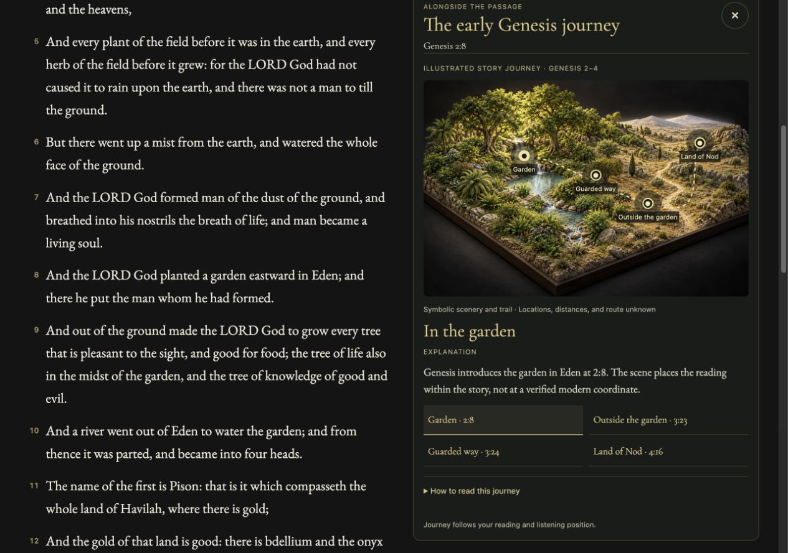

# The Bible

Hosted reader: <https://bible-in-rust.daeshawnballard.chatgpt.site>. Open-source repository: <https://github.com/daeshawnballard/rust-bible>.


A daily KJV reading, illustrated Library, and continuous chapter reader with a passage-following Journey and contextual illustrations, built from one shared Rust implementation. The **About** page explains how to read, listen, and use local reading progress. Run the site as the original Axum + Tokio server, or build it as Rust WebAssembly for static hosting. Rust handles Bible lookup, reference parsing, search, Library filtering and sorting, and page rendering. Small JavaScript modules connect browser routes, Library controls, and local speech playback to that Rust implementation.

## Illustrated Journey scenes

Journey now includes six illustrated story worlds: the original Eden scene plus five new individual landscapes for Noah and the flood (Genesis 7–9:17), the Exodus wilderness (Exodus 13:17–17), Ruth’s return (Ruth 1–2), Luke’s birth narrative (Luke 2), and the Galilee crossing (Mark 4–5). Choose **Journey** inside the passage; a small indicator marks chapters with illustrated coverage.

Real hotspots and source links sit over the artwork. The active stop follows the verse as you scroll or listen, including return visits to an earlier setting. Deliberately selecting a hotspot’s reference chooses that verse and stops narration; context updates from ongoing reading do not restart audio. Scripture remains separate from the illustrated explanations.

The miniatures compress times and places into one artistic storyboard; they are not surveyed ancient maps. Explicit verse ranges prevent a setting from carrying into unrelated passages. Existing curated terrain, the three object studies, the Library, and free continuous audio remain available. See [coverage and interaction notes](docs/illustrated-journeys.md), [exact generation prompts](assets/imagegen/journey/), and [asset provenance](assets/imagegen/manifest.json).

## Today and navigation

**Today** is the default homepage: a short KJV passage, a separate illustration, **Read** for its full chapter, and **Listen** for that passage. Edition 2 uses a clearly labeled, curated 42-day rotation selected from the browser’s local calendar date. The original edition 1 remains an immutable 14-day sequence, and its shared links keep their edition and date. **Link to this day** preserves both so the selection stays stable when shared. Illustrations are artistic interpretations; Scripture comes verbatim from the embedded corpus.

**Library** is the gallery of all 66 books. The main flow is **Books → Passage**: a cover opens the chapter reader directly. The Book and Chapter selectors and an expandable **All chapters** grid keep navigation inside the reader. Reader breadcrumbs follow **Library / Book / Chapter**. The header stays consistent throughout the site. The primary navigation is **Today / Library**. Listening belongs to the open passage. Journey and hotspot browsing retain that same audio queue. **Journey** and relevant **Illustrations** open inside the chapter reader, alongside its single Scripture stream and audio player. Old Explore and study links redirect into the corresponding reader. **About** offers getting-started links and common answers.

**Continue reading** remembers the exact verse on this browser/device after a chapter is opened. The saved location uses browser-local storage; it is not an account or cloud sync. **Continue reading** appears near the heading on Today and Library. The matching book’s cover and Read link resume that same exact verse; other books open chapter 1. Choose Chapter 1 inside the reader to start over. **Clear** on either continuation row removes that saved location. Clearing site data or using private browsing can affect retention. The Library also restores its filters, cover size, and scroll position within the browser session.

**About and help** is available at `/about`. It explains passage lookup, reading and listening controls, illustrated-scene notes, and local progress.

## Illustrated Library

The Library is a gallery of all 66 books, with individual painted cover illustrations, live HTML titles, short editorial descriptions, and chapter links. Each cover and **Read** link opens the reader directly, resuming the current bookmark when that book matches, or starting at chapter 1 otherwise.

The Library uses medium-weight descriptions and stronger reading links, with restrained gold highlights on its dimensional covers. The compact floating **Library tools** bar filters by testament and category, sorts by Bible order, title, or chapter count, and changes cover size. Filters combine, selections are reflected in the URL, and **Reset** returns to all 66 books. On narrow screens the toolbar can collapse and the gallery adjusts to the available width. The header retains the reader's explicit fuzzy book suggestions and passage lookup.

The 66 cover scenes were generated individually with built-in ImageGen from the approved Library reference. Titles, descriptions, links, and controls remain live HTML/CSS. A generated transparent binding overlay supplies the dimensional leather spine, raised bands, and ornate gold tooling; each painting remains a separate image. These illustrations and descriptions are editorial aids, separate from the KJV text. Original PNGs are preserved in `assets/imagegen/source/covers/`, optimized production WebPs in `web/art/covers/`, and prompts, source output identifiers, processing, and dimensions in [the asset manifest](assets/imagegen/manifest.json) and [per-book provenance](assets/imagegen/covers/). See [artwork notes](docs/library-artwork.md).

## Books → Passage

The reader contains chapter selection, continuous read-aloud audio, passage-following Journey, and relevant illustrated hotspots. There is no separate book-overview screen between a cover and Scripture. Existing `/book/{name}` links redirect to chapter 1; explicit chapter/verse links keep their destination. The illustrated covers, live descriptions, category filters, fuzzy lookup, and floating Library tools remain unchanged.

Use **Book** and **Chapter** at the top of the passage, or expand **All chapters** below it. Psalms includes all 150 chapters; single-chapter books include one. The current chapter is marked. These controls lead directly to canonical reader routes, and the Library breadcrumb restores the gallery.

**Listen from here** starts at the selected verse and continues into subsequent chapters. The same player remains available while opening Journey or browsing hotspot details. A deliberate source-reference jump stops narration so the next Listen starts at that source. Stop, pause/resume, speed, voice, and Follow reading remain in the reader. Free Kokoro narration is generated locally; the first listen downloads about 100 MB of public model files. No paid narration API is used.

The earlier book-overview concept and screenshots remain in the repository as historical design artifacts; they no longer describe the public navigation. All production cover art and generation provenance are preserved.

## Visual finish

The charcoal, warm-gold, and locally hosted serif styling continues through Today, the 66-book Library, the reader, passage companion, search, recovery, and help. Chapter buttons have clearer states; the Library keeps its illustrated covers and floating tools. Reader audio status stays in normal document flow so it cannot cover the first verse. Scripture and editorial explanations remain distinct.



[Mobile chapter reader](docs/site-polish-reader.jpg) · [Illustrated study and dedicated object panel](docs/site-polish-study.jpg)

The screenshots above are actual browser captures, not ImageGen mockups. Approved design references and existing artwork provenance remain unchanged. The October 16 polish pass was exercised through local browser routes at desktop and narrow widths; see [design QA](design-qa.md) for its evidence boundaries.

Natural narration still uses the free browser-local Kokoro voices. The available voice catalog does not document Black speaker identity, so these voices are not labeled Black. No paid narration API has been added.

## Native server

Requirements: a current stable Rust toolchain. The KJV JSON is embedded in the binary with `include_str!`, so no runtime data file is needed.

```sh
cargo run --release
```

Open <http://localhost:3000>. The server binds to `0.0.0.0:3000`.

## Static browser build

Install the WebAssembly target once:

```sh
rustup target add wasm32-unknown-unknown
```

Build the static site:

```sh
./scripts/build-wasm.sh
```

The command writes the site shell and WASM module, Today artwork, all 66 cover WebPs, and the illustrated scene, object detail, and Genesis journey assets to `dist/`. Publish the contents of `dist/` on any static host. Original ImageGen PNGs and provenance stay in the source repository and are not copied into the deployed bundle. The page shows a loading state, reports WebAssembly or asset-loading errors, and includes a no-JavaScript message. It does not use `wasm-bindgen`, `wasm-pack`, or a server-side process.

For a local static preview after building:

```sh
python3 -m http.server 8000 --directory dist
```

Then open <http://localhost:8000>.

The native service keeps its JSON routes:

- `/api/verse?ref=John+3:16`
- `/api/search?q=faith`

A static host cannot run Axum or provide these as HTTP endpoints. The same JSON behavior is available inside the browser page through the Rust WASM adapter, for example `window.rustBibleApi("/api/verse?ref=John%203%3A16")`. It returns the parsed JSON object. This hosted API boundary is an in-page JavaScript call into Rust WebAssembly, not a network endpoint.

## Reader features


- A quiet chapter reader for all 66 books, with book/chapter selectors, contextual speech controls, and previous/next chapter links across book boundaries.
- Short readings continue directly into following Scripture, with clear chapter headings and **Open chapter** links. Verse lookups show the requested range first, then continue after its final verse. The initial page includes whole following chapters until at least 16 verses are rendered (at most three added sections, or the end of Scripture); a **Continue with…** link opens the next unread chapter. The end of Revelation stops naturally.
- **Listen from here** reads the selected Scripture and continues into following chapters. Further chapters are appended by the Rust renderer as playback reaches the end of the displayed text, through the end of Revelation. The current verse is highlighted; **Follow reading** scrolls it into view and can be switched off under **Playback options**. Playback controls stay accessible while reading. Pause/resume, stop, voice/speed settings, and cancellation on navigation remain available. Today reads only its selected passage. Opening or browsing the reader companion does not restart the reader or its audio.
- **Continue reading** remembers the exact verse on this browser/device. Settled scrolling saves the verse at the reading line; during audio, the currently spoken verse takes precedence. Today’s and Library’s Continue reading links, the matching Library cover, and reloading the same chapter return to that verse, including chapters reached through continuous reading. **Listen from here** starts there after a click. The reader’s Listen control starts from that restored verse. Older chapter-only bookmarks still open correctly. Use **Clear** on Today to remove the bookmark. Progress uses local browser storage, with no account or cloud sync; clearing site data or private browsing can affect retention. If storage is unavailable, reading and speech remain usable but progress may not survive a reload.
- Reference lookup such as `John 3:16`, `John 3`, `1 Cor 13:4-7`, and `ps 23`; names are case-insensitive and common abbreviations are supported.
- Typo-tolerant book suggestions: `neimai` suggests Nehemiah, and `jhon` suggests John. Chapter and verse requests stay attached to valid suggestions. Corrections are explicit links; keyword search still returns exact text matches.
- Full-text search where every query word must match, with up to 200 displayed results and escaped highlighting.
- Verse ranges and highlighted chapter links.

## One reader, with context alongside


[Tabernacle details alongside the chapter](docs/reader-illustrations.jpg). These two images are real local-browser captures of the integrated Rust/WASM reader at 1280 × 900, not design mockups. Hosted verification is separate.

**Passage** is the default reading view. Book and chapter navigation, continuous KJV text, exact-verse progress, and one **Listen from here** player share the same reader. **Text settings** adjusts size and line spacing and remembers those choices locally. Desktop context sits beside the passage; on narrow screens it moves into normal document flow without a nested Scripture scroll pane. Explicit illustrated links bring that companion into view on narrow screens; **Read [reference]** moves to the Scripture instead.

**Illustrations** appears when a chapter has a relevant study: Noah’s Ark in Genesis 6–9, the Tabernacle in Exodus 25–31 and 35–40, and the Sower in Matthew 13. The three existing scenes retain all 16 hotspots and their individual object/detail artwork. **Scene / Detail** switches between the scene and its object card in the same companion, rather than stacking both tall images. A hotspot or the labeled detail selector changes the illustration and explicitly labeled explanation without moving the reading bookmark. **Read [reference]** deliberately moves the Scripture to that source passage. **Follow passage** returns from a browsed object to source-matched details as scrolling or narration advances. No explanation is added to the Scripture DOM or speech queue.

Canonical share links use the reader, for example:

- `#/book/Exodus/25?resume=31&context=illustration&scene=tabernacle&part=lamp#v31`
- `#/book/Genesis/3?resume=23&context=journey#v23`
- `#/book/Acts/16?resume=12&context=journey#v12`

Legacy `#/explore`, map parameters, and the three scene URLs remain compatible through redirects. They are no longer separate primary destinations. Today and the Library remain the two entry points.

## Journey follows the passage

Genesis 2–4 has an **illustrated story journey**: the garden, outside the garden, the guarded way, and Cain’s land of Nod. The active stage follows the exact verse while reading or listening. The landscape and trail are symbolic scenery, with no GPS coordinates or claim to known locations, distances, or an actual route. Genesis 3:24’s guardians east of Eden do not establish a surveyed expulsion trail; Genesis 4:16’s move to Nod follows Cain.

Geographic context uses sourced, curated settings in Acts 16–17 and Revelation 1:9. The camera follows the current setting locally. **Route overview** deliberately widens to that chapter’s curated stops; panning pauses camera follow until **Follow passage** is selected. Named places elsewhere in the book do not populate a fallback world map. Unsupported passages show a compact, honest empty state while their full Scripture remains readable.

Geographic explanations, source links, and uncertainty are separate from Scripture and speech. Dashed connections are schematic, not reconstructed ancient routes. Modern NASA Blue Marble regional imagery (approximately 500 m, not street-level) and Mapzen elevation tiles require a network connection and WebGL. If terrain fails, the KJV passage and source-linked stops remain usable. The app does not request your physical location. See [atlas attribution and limits](docs/atlas-data.md), [renderer provenance](web/vendor/maplibre/provenance.json), and [reader companion notes](docs/reader-companion.md).

The app, reference validation, scene selection, source matching, journey state, and API/page rendering stay in Rust/WASM. Small JavaScript bridges handle browser events, WebGL terrain, and narration. The approved earlier map concept is retained as design provenance; generated scenery is never substituted for geographic terrain.

## Connected reading experience

Today and Library open the same canonical passage reader. The selected **Quiet Canvas** treatment lets Scripture expand into a reading column or contract into a floating window over a full-screen Journey. The window switches between Scripture, clearly labeled context, and the Bible Codex. Inspecting a hotspot keeps the reading location; its explicit source link moves to that passage.

One browser-local narrator and bottom audio dock survive navigation within the WASM app. The dock names the actual playing passage, returns to it, supports pause/resume, speed, voice, volume and follow controls, and continues across chapter boundaries. The waveform, elapsed time and seek control use the generated Kokoro audio chunk; they are not a chapter-duration estimate. Device voices do not expose PCM or timing, so waveform, duration and seek remain unavailable for that option. Reloading remembers the verse; it does not autoplay.

The **Bible Codex** is one book-by-book reference companion with 212 selected entries across all 66 books: people, places, miracles and study notes. Each entry links to a valid KJV verse. This is a curated starting index, not an exhaustive list of every person, place, event or interpretation. It is available from Library and the reader window, with book/category/text filters. Scripture continues to come from the embedded corpus, separately from editorial notes.

Journey coverage stays limited to the authored passage ranges documented in [reader companion notes](docs/reader-companion.md). Unassigned passages retain the full reading/listening experience. The Genesis scenery is illustrative, with unknown real-world locations; it is not a geographic reconstruction. Existing Tabernacle object artwork and the other illustrated studies remain in the passage.

Approved screen references are kept in [the reference folder](assets/imagegen/reference). The new full-screen Genesis background has [source and generation provenance](assets/imagegen/journey/genesis-immersive-v1.json). Covers, scene art and object illustrations are individual production assets; titles, Scripture, descriptions, navigation and controls remain real Rust-rendered interface elements.

## Data source

<https://raw.githubusercontent.com/thiagobodruk/bible/master/json/en_kjv.json> (KJV, public domain). The source file's book names are in Portuguese, so English names are supplied in code by book order.

## License

Code is released under the MIT License (see `LICENSE`). The King James Version text is in the public domain, sourced from [thiagobodruk/bible](https://github.com/thiagobodruk/bible).
